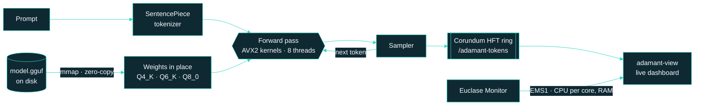
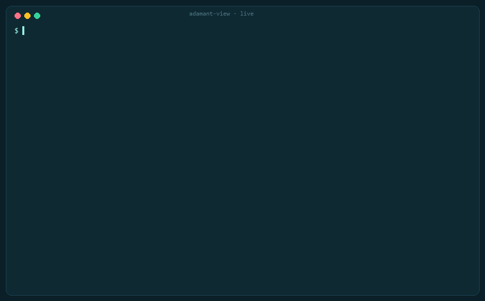
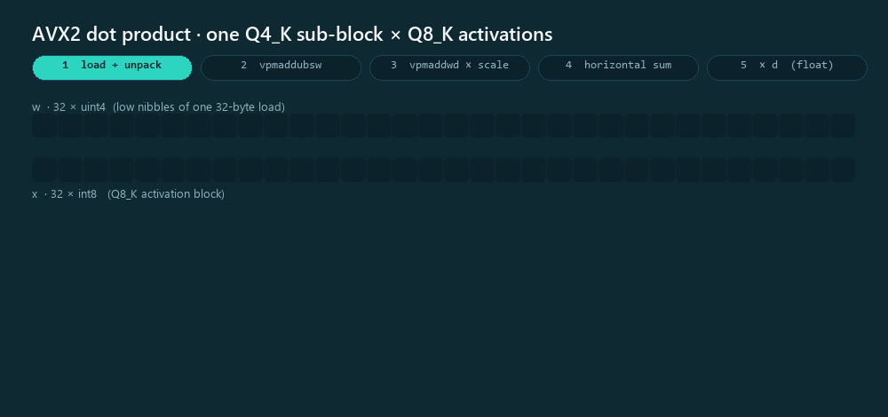
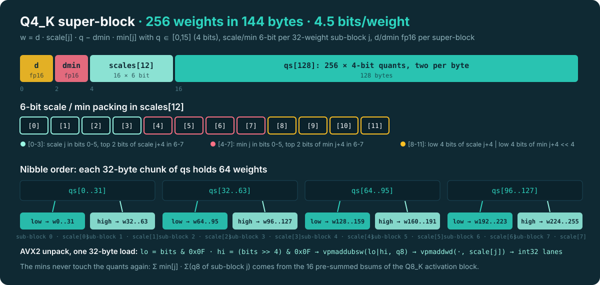
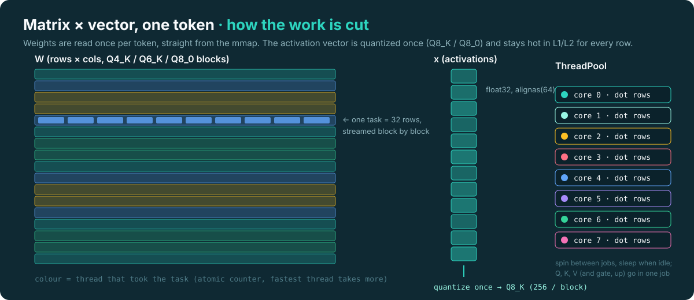
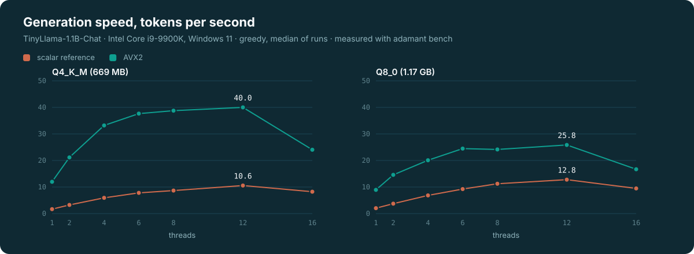
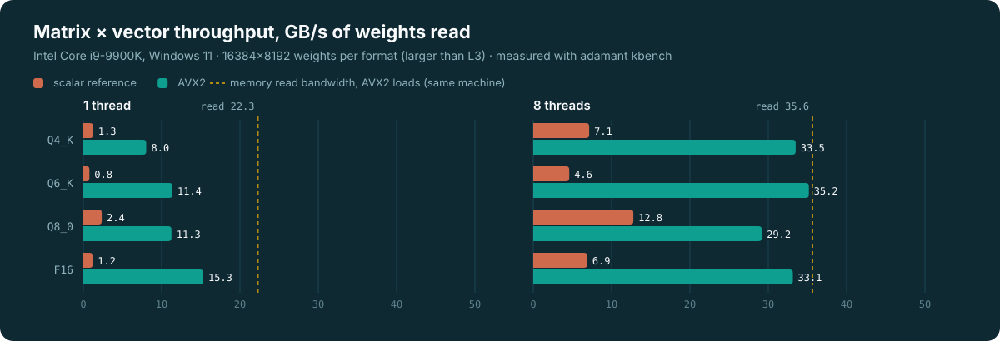
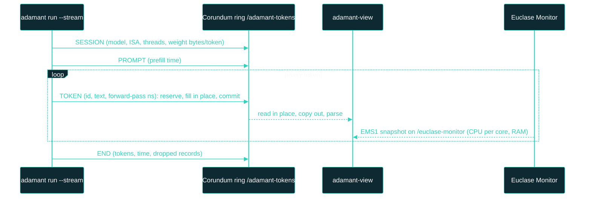

<p align="center"></p>

<p align="center">
  <a href="https://github.com/SemyonZamiakin/Adamant/actions/workflows/ci.yml"></a>
  
  
  
  
  
</p>

<h3 align="center">A large language model on your CPU, in about 3 100 lines of C++17.<br>Weights stream straight from the file. Hand-written AVX2, bit-identical to the scalar reference.</h3>

<p align="center">
  <a href="#see-it-run">Demo</a> ·
  <a href="#quick-start">Quick start</a> ·
  <a href="#how-it-works">How it works</a> ·
  <a href="#benchmarks">Benchmarks</a> ·
  <a href="#correctness">Correctness</a> ·
  <a href="docs/DESIGN.md">Design</a> ·
  <a href="README.uk.md">Українською</a>
</p>

<p align="center"></p>

## Overview & Use Cases

> **In one sentence:** Adamant loads a quantized LLM from a GGUF file and generates text on an ordinary x86-64 CPU, with every hot loop written by hand in AVX2 and checked bit for bit against a plain scalar version.

**Why it exists.** Generating a token means reading every weight of the model once. On a CPU that is a
memory-bandwidth problem first and an arithmetic problem second, and most of the work hides inside a handful of
loops: unpack 4- and 6-bit numbers, multiply, add. Adamant is those loops, written out in full and kept small
enough to read in an evening: a zero-copy loader that maps the weights straight from disk, integer AVX2 kernels
for the block formats llama.cpp popularised, cache-line-aligned buffers, and a forward pass for llama-family
models. Every claim it makes is measured on the machine named next to the number, and every SIMD kernel has a
scalar twin it must match exactly. Generated tokens and live CPU / RAM load flow through the rest of the Euclase
stack: [Corundum HFT](https://github.com/SemyonZamiakin/CorundumHFT) and
[Euclase Monitor](https://github.com/SemyonZamiakin/EuclaseMonitor).

<table>
  <tr>
    <td width="33%" valign="top"><b>Local, private inference</b><br><sub>Chat with a small model on a laptop or an old desktop: no GPU, no network, no Python runtime. One executable and a GGUF file.</sub></td>
    <td width="33%" valign="top"><b>Learn how inference really works</b><br><sub>Q4_K bit packing, <code>vpmaddubsw</code>, KV cache, RoPE, grouped-query attention: each one is a few dozen readable lines, with a test next to it.</sub></td>
    <td width="33%" valign="top"><b>Kernel lab</b><br><sub>Try a new SIMD kernel against a bit-exact scalar oracle and see its GB/s next to the machine's measured memory read bandwidth, in one command.</sub></td>
  </tr>
  <tr>
    <td width="33%" valign="top"><b>Embed an LLM in a C++ app</b><br><sub>A static library with a small API (<code>Model</code>, <code>Tokenizer</code>, <code>Sampler</code>) and no dependencies beyond the vendored Corundum ring.</sub></td>
    <td width="33%" valign="top"><b>Stream tokens to other processes</b><br><sub>Tokens and timing go out on a lock-free shared-memory ring: a UI, a logger or a game can read them with zero copies and never slow generation down.</sub></td>
    <td width="33%" valign="top"><b>Reproducible results</b><br><sub>Greedy output is identical with 1 or 16 threads, scalar or AVX2: handy for regression tests and for comparing kernels.</sub></td>
  </tr>
</table>



**New here?** Watch the [demo](#see-it-run), then follow the [quick start](#quick-start): one build, one model download, one command.
Adamant is version 0.1.0; [Status and limits](#status-and-limits) says exactly what it does and does not do yet.

<p align="center"></p>

<h3 align="center">In numbers</h3>

<table align="center">
  <tr>
    <td align="center" width="25%"><h2>38.8 tok/s</h2><sub>TinyLlama-1.1B Q4_K_M generation on an i9-9900K, 8 threads, AVX2</sub></td>
    <td align="center" width="25%"><h2>24.4 GB/s</h2><sub>of weights streamed from DRAM while generating: 68% of the machine's measured read bandwidth</sub></td>
    <td align="center" width="25%"><h2>×7.8</h2><sub>AVX2 over the scalar reference, Q4_K matrix-vector on one core (data in cache; ×6.4 from DRAM)</sub></td>
    <td align="center" width="25%"><h2>0 bits</h2><sub>of difference between AVX2 and scalar: same logits, same tokens (3.8 M kernel results compared)</sub></td>
  </tr>
</table>

<p align="center"></p>

## See it run

<p align="center"></p>

<p align="center"><sub>A real recording, replayed in real time: <code>adamant run --stream</code> generates with TinyLlama-1.1B-Chat Q4_K_M; <code>adamant-view</code> reads the tokens from the Corundum ring and the per-core CPU load and RAM from Euclase Monitor's ring.</sub></p>

```text
$ adamant run -m tinyllama-1.1b-chat-v1.0.Q4_K_M.gguf --chat -p "Explain in three sentences what a CPU cache is."
model     tinyllama_tinyllama-1.1b-chat-v1.0 · 22 layers · dim 2048 · 32 heads (4 kv) · vocab 32000
weights   600.7 MiB, mapped zero-copy (F32 0.4 MiB, Q4_K 490.2 MiB, Q6_K 145.6 MiB)
runtime   avx2 kernels · 8 threads · ctx 2048 · KV cache 88.0 MiB · loaded in 23 ms
stream    Corundum ring /adamant-tokens (watch it with adamant-view)

A CPU cache is a temporary storage area within the CPU that stores frequently accessed data and instructions.
It is designed to speed up the execution of instructions by quickly retrieving the data from the cache when it
is needed. The cache is typically located near the CPU's memory, and it is updated frequently to ensure that
the data is always up-to-date. The cache is designed to store data for a limited time, typically around 10-100
times faster than the memory. The cache is used to reduce the time required to

prompt   28 tokens in 0.86 s (32.4 tok/s, one token at a time)
generate 110 tokens, 38.3 tok/s, 26.1 ms/token, weights streamed at 24.1 GB/s
stream    113 records published, 0 dropped
```

## Quick start

**1. Build** (Windows with MSYS2 MinGW-w64, or Linux with GCC / Clang):

```bash
cmake -S . -B build -DCMAKE_BUILD_TYPE=Release
cmake --build build -j
ctest --test-dir build
```

On Windows from Git Bash or PowerShell, add `-G "MinGW Makefiles"` (or `-G Ninja`) with `C:\msys64\mingw64\bin` on `PATH`.
The executables are `build/adamant` and `build/adamant-view`.

**2. Get a model.** Any llama-architecture GGUF with Q4_K, Q6_K, Q8_0, F16 or F32 tensors and a SentencePiece
vocabulary works. The numbers in this README use TinyLlama-1.1B-Chat v1.0 from
[TheBloke/TinyLlama-1.1B-Chat-v1.0-GGUF](https://huggingface.co/TheBloke/TinyLlama-1.1B-Chat-v1.0-GGUF):

| File | Size | SHA-256 |
|---|---|---|
| `tinyllama-1.1b-chat-v1.0.Q4_K_M.gguf` | 669 MB | `9fecc3b3cd76bba89d504f29b616eedf7da85b96540e490ca5824d3f7d2776a0` |
| `tinyllama-1.1b-chat-v1.0.Q8_0.gguf` | 1.17 GB | `a4c9bb1dbaa372f6381a035fa5c02ef087aaa1ff1f843a56a22328114f03fc59` |

**3. Run:**

```bash
adamant run -m tinyllama-1.1b-chat-v1.0.Q4_K_M.gguf --chat -p "Write a haiku about vector registers."
adamant run -m tinyllama-1.1b-chat-v1.0.Q4_K_M.gguf -p "Once upon a time" -n 200 --temp 0.8 --seed 7
```

**4. Watch it live** (second terminal; start Euclase Monitor too for per-core load from its ring):

```bash
adamant-view                      # waits for a generation
adamant run -m model.gguf --chat -p "..." --stream
```

## How it works

Four ideas carry the whole engine. [docs/DESIGN.md](docs/DESIGN.md) has the full story.

**1. Never copy the weights.** The GGUF file is mapped read-only (`mmap` / `CreateFileMapping` + `MapViewOfFile`)
and every tensor is a pointer into the mapping. Loading takes milliseconds, pages come from the OS cache on
demand, two processes share one copy, and a model larger than free RAM pages from disk instead of hanging the
machine in swap.

**2. Integer SIMD on packed blocks.** The activation vector is quantized to int8 once per matrix product; then
each weight block is unpacked with shifts and masks and multiplied with `vpmaddubsw` (u8 × s8 → pairs of int16)
and `vpmaddwd` (× the block's scale → int32). One 32-byte load carries 64 Q4_K weights.

<p align="center"></p>

<p align="center"></p>

**3. Bit-identical to scalar, by construction.** Each block's integer sum is exact in any order, and the float
scales are applied block by block in the same order with the same operations (`-ffp-contract=off`). The float
dot products in attention use the same 4 × 8 partial sums and reduction tree in both versions. Result: AVX2 and
the scalar reference produce the same logits and the same tokens, which turns the scalar code into an exact test
oracle for every SIMD change.

**4. Cut the work for the cache and the cores.** Rows are handed to threads 32 at a time through one atomic
counter; Q, K and V (and the MLP's gate and up) run as one job; every buffer Adamant owns is 64-byte aligned and
rounded to whole cache lines; hot atomics sit on their own lines.

<p align="center"></p>

## Benchmarks

Measured on **Intel Core i9-9900K** (8 cores / 16 threads, Coffee Lake, AVX2), dual-channel DDR4, **Windows 11**,
Adamant built with MSYS2 GCC 15.2 `-O3`. Raw logs and CSV: [docs/bench/](docs/bench/).

### Generation speed

<p align="center"></p>

| Threads | Q4_K_M scalar | Q4_K_M **AVX2** | speed-up | AVX2 weights GB/s | Q8_0 scalar | Q8_0 **AVX2** | speed-up | AVX2 weights GB/s |
|---:|---:|---:|---:|---:|---:|---:|---:|---:|
| 1 | 1.67 | **12.0** | ×7.2 | 7.5 | 2.04 | **8.9** | ×4.4 | 9.8 |
| 2 | 3.25 | **21.2** | ×6.5 | 13.3 | 3.74 | **14.6** | ×3.9 | 16.0 |
| 4 | 5.94 | **33.2** | ×5.6 | 20.9 | 6.84 | **20.1** | ×2.9 | 22.1 |
| 6 | 7.81 | **37.7** | ×4.8 | 23.7 | 9.23 | **24.5** | ×2.7 | 26.9 |
| 8 (default) | 8.66 | **38.8** | ×4.5 | 24.4 | 11.23 | **24.2** | ×2.2 | 26.6 |
| 12 | 10.57 | **40.0** | ×3.8 | 25.2 | 12.79 | **25.8** | ×2.0 | 28.4 |
| 16 | 8.24 | **24.0** | ×2.9 | 15.1 | 9.48 | **16.7** | ×1.8 | 18.3 |

<sub>Tokens per second. Weight bytes read per token: 630 MB (Q4_K_M), 1 099 MB (Q8_0).</sub>

<sub>`adamant bench -m MODEL --isa scalar,avx2 -t 1,2,4,6,8,12,16 -n 64 --reps 3`: greedy generation after an 8-token prompt; median of 3 AVX2 runs of 64 tokens (scalar: one run of 16 tokens). "Weights GB/s" = weight bytes read per token × tokens/s.</sub>

**Same machine under Linux** (WSL2, kernel 6.18, GCC 15.2, model on the Linux file system; `scripts/bench-linux.sh`):

| Threads | Q4_K_M scalar | Q4_K_M **AVX2** | Q8_0 scalar | Q8_0 **AVX2** |
|---:|---:|---:|---:|---:|
| 1 | 1.71 | **13.0** | 2.08 | **9.1** |
| 4 | 5.90 | **38.3** | 7.14 | **19.9** |
| 8 | 9.62 | **45.0** | 11.64 | **21.8** |
| 12 | 11.76 | **44.7** | 12.46 | **22.1** |

<sub>Tokens per second. Q4_K_M at 8 threads streams 28.3 GB/s of weights here, against 24.4 GB/s on Windows; the cause has not been investigated yet (thread scheduling and timer behaviour differ between the two kernels).</sub>

### Kernels

<p align="center"></p>

| Format | bits/weight | scalar, 1 thread | **AVX2, 1 thread** | speed-up | scalar, 8 threads | **AVX2, 8 threads** | AVX2, 1 thread, data in L2/L3 | speed-up in cache |
|---|---:|---:|---:|---:|---:|---:|---:|---:|
| Q4_K | 4.5 | 1.26 | **8.04** | ×6.4 | 7.14 | **33.5** | 9.10 | ×7.8 |
| Q6_K | 6.56 | 0.78 | **11.4** | ×14.6 | 4.59 | **35.2** | 14.8 | ×19.5 |
| Q8_0 | 8.5 | 2.35 | **11.3** | ×4.8 | 12.8 | **29.2** | 15.8 | ×7.0 |
| F16 | 16 | 1.20 | **15.3** | ×12.8 | 6.90 | **33.1** | 30.3 | ×25.4 |
| *memory read* | | | *22.3* | | | *35.6* | | |

<sub>GB/s of weights. Large shape: 16 384 × 8 192 weights per format (75 to 268 MB); cache shape: 1 024 × 2 048.</sub>

<sub>`adamant kbench -t 1,8`: matrix-vector product on synthetic weights, including quantization of the input vector; GB/s = weight bytes / time. "Memory read" is the same machine summing a 1 GiB buffer with AVX2 loads: the reference for what DRAM delivers.</sub>

**Reading the numbers.** With all 8 cores, the AVX2 kernels read weights at 29 to 35 GB/s, about the 35.6 GB/s at which this machine can
read memory at all: the arithmetic is no longer the limit, DRAM is. A full generation step reaches 24.4 GB/s
(Q4_K_M, 8 threads, 68 % of that), because a token is also attention, normalisation, activation quantization and
~150 thread-pool hand-offs, and the smallest matrices (K and V: 2048 × 256) are too short to keep 8 cores busy.
On one core the picture is different: the scalar reference is bound by arithmetic, and AVX2 is 4.8 to 14.6 times
faster (7 to 25 times with the data in cache). With 16 threads generation slows down: the spinning workers on
hyper-threads compete with the ones doing the work, so the default is the number of physical cores. Runs vary by
about ±10 % (another Q4_K kernel run gave 28.7 instead of 33.5 GB/s at 8 threads); the logs keep every run.

## Correctness

**Against an independent reference.** [`scripts/reference_logits.py`](scripts/reference_logits.py) runs the same
model in numpy, in double precision, with weights dequantized by the `gguf` package from the llama.cpp project
(not by Adamant's code) and unquantized activations. Last-position logits after the 14-token prompt
*"The capital of France is Paris, and the capital of Japan is"*:

| Model | cosine | max \|Δ logit\| | mean \|Δ logit\| | top-1 | top-10 overlap | KL(ref ‖ Adamant) |
|---|---:|---:|---:|:---:|---:|---:|
| Q4_K_M | 0.99985 | 0.42 (range −15.9 … 18.4) | 0.072 | same (`Tokyo`) | 9 / 10 | 4.5 × 10⁻⁵ nats |
| Q8_0 | 0.99996 | 0.20 (range −16.4 … 18.7) | 0.035 | same (`Tokyo`) | 10 / 10 | 3.4 × 10⁻⁶ nats |

The small remaining difference is Adamant's 8-bit quantization of activations before each matrix product (the
same scheme llama.cpp uses on CPU). Both models answer *"Tokyo"*.

**Test suites** (run on every push, Linux and Windows):

| Suite | What it proves |
|---|---|
| `test_kernels` | AVX2 = scalar **bit for bit** on random raw blocks: 3.8 M results across quantizers, Q4_K / Q6_K / Q8_0 / F16 / F32 dot products and dequantizers, including rows that are only 2-byte aligned |
| `test_model` | a synthetic llama model using every weight format vs a **double-precision implementation** written in the test (cosine ≥ 0.999); 1 vs 8 threads and AVX2 vs scalar engine bit-identical |
| `test_quant` | round-trip error per format on Gaussian data (Q8_0 0.54 %, Q6_K 1.9 %, Q4_K 7.9 % relative RMSE); quantized dot products vs float |
| `test_gguf` | writer → reader round-trip; truncation at every length and 1 500 random corruptions never read outside the file |
| `test_tokenizer` | merge order by score, byte fallback, special tokens, decoding |
| `test_fp16` | all 65 536 half-precision values round-trip; ties round to even |
| `test_thread_pool` | every task runs exactly once over thousands of jobs, also after workers go to sleep |
| `test_stream` | records cross a real Corundum ring intact; a full ring drops instead of blocking |

CI matrix: Linux GCC and Clang (Release, Debug), **AddressSanitizer + UndefinedBehaviorSanitizer**,
**ThreadSanitizer**, a build without AVX2; Windows MinGW-w64 (MINGW64 and UCRT64).
Both TinyLlama files were also run end to end under AddressSanitizer + UndefinedBehaviorSanitizer with leak
detection (Linux, GCC 15.2, scalar and AVX2): no reports.

## Euclase integration



- **[Corundum HFT](https://github.com/SemyonZamiakin/CorundumHFT)** 1.2.0 is vendored in `third_party/corundum`.
  The token stream format is [`include/adamant/token_wire.h`](include/adamant/token_wire.h); its structs are
  checked at compile time with Corundum's `CRD_WIRE_PACKED`. The producer never waits: when nobody reads and the
  ring fills, records are dropped and counted.
- **[Euclase Monitor](https://github.com/SemyonZamiakin/EuclaseMonitor)** 1.1 publishes EMS1 snapshots on
  `/euclase-monitor`; `adamant-view` reads `cpu.core<N>.load`, `cpu.load`, `ram.used_gb`, `ram.total_gb` and
  `cpu.name`. Without Monitor the viewer samples CPU and RAM itself. A Corundum ring has one reader, so while the
  viewer reads Monitor's ring another reader (Euclase Light) cannot; `adamant-view --no-monitor` leaves it free.

## Command reference

| Command | What it does |
|---|---|
| `adamant run -m M -p TEXT [-n 128] [--chat] [--system S]` | generate; `--temp`, `--top-k`, `--top-p`, `--repeat-penalty`, `--seed`, `-t`, `-c`, `--isa scalar\|avx2`, `--stream`, `--warm` |
| `adamant bench -m M [--isa scalar,avx2] [-t 1,8] [-n 64] [--csv F]` | end-to-end tokens/s and weight GB/s |
| `adamant kbench [-t 1,8] [--rows R --cols C] [--csv F]` | kernel micro-benchmark and memory read bandwidth, no model needed |
| `adamant info MODEL [--tensors]` | metadata, tensor types and sizes |
| `adamant logits -m M (--tokens 1,2,3 \| -p TEXT) [--out F]` | final-position logits, for reference comparisons |
| `adamant tokenize -m M -p TEXT [--chat]` | token ids and pieces |
| `adamant-view [--record F.jsonl] [--exit-on-end] [--no-monitor]` | live dashboard for `--stream` |

`ADAMANT_ISA=scalar` forces the scalar kernels in any program linking the library.

## Status and limits

Adamant 0.1.0 is a working engine, not a llama.cpp replacement. What is true today:

- **Models:** llama architecture only (TinyLlama, Llama-2-style models, many fine-tunes) with the SentencePiece
  tokenizer. GPT-2-style BPE vocabularies (Llama-3, Qwen, SmolLM) and other architectures are refused with a clear
  error. Tested end to end with TinyLlama-1.1B-Chat v1.0 (Q4_K_M and Q8_0); other files are expected to work if
  they use the same tensor names and formats, but have not been tried.
- **Formats:** Q4_K, Q6_K, Q8_0, F16, F32. No Q2_K / Q3_K / Q5_K / Q4_0 / IQ formats; no own weight format.
- **Prompt processing is one token at a time** (matrix-vector, not matrix-matrix): prefill runs at roughly
  generation speed. Batched prefill is the biggest missing optimisation.
- **KV cache is float32**, context up to the model's training length (TinyLlama: 2048, 88 MiB of cache).
- **x86-64 only** for SIMD: AVX2 + FMA + F16C, with the scalar path everywhere else (it is also built and tested
  without AVX2). No AVX-512, no ARM NEON yet.
- **Benchmarks are from one machine** (i9-9900K) under Windows 11 and WSL2 Linux. Other CPUs will differ; please send results.
- **The viewer is a console dashboard**, not a tray application.
- Text quality is the model's: TinyLlama is a 1.1 B model and gets facts wrong; Adamant reproduces its
  reference logits, not better answers.

## Roadmap

- Batched prefill (matrix-matrix kernels with register tiling).
- AVX-512 / VNNI and ARM NEON kernels, each with the same bit-exact scalar contract.
- GPT-2 BPE tokenizer (Llama-3, Qwen, SmolLM families), Q5_K / Q4_0 formats.
- Quantized (Q8) KV cache.

## Building

| | |
|---|---|
| **Windows** | MSYS2 MinGW-w64 GCC (tested 15.2, MINGW64 and UCRT64) or clang; `cmake -G "MinGW Makefiles"` or `-G Ninja`. Executables are linked statically |
| **Linux** | GCC (tested 15.2) or Clang (tested 21.1); `scripts/check-linux.sh` builds Release, ASan + UBSan and TSan with both |
| **Options** | `-DADAMANT_AVX2=OFF` scalar only · `-DADAMANT_NATIVE=ON` `-march=native` · `-DADAMANT_SANITIZE=address,undefined` · `-DADAMANT_WERROR=ON` |

## Part of Euclase

| Project | What it is |
|---|---|
| [Corundum HFT](https://github.com/SemyonZamiakin/CorundumHFT) | zero-copy lock-free IPC ring: carries Adamant's tokens |
| [Euclase Monitor](https://github.com/SemyonZamiakin/EuclaseMonitor) | system monitor: publishes the CPU and RAM metrics the viewer shows |
| [Vajra Binary Core](https://github.com/SemyonZamiakin/VajraBinaryCore) | live patching and type migration for running C++ programs |
| [Euclase SessionGuard](https://github.com/SemyonZamiakin/EuclaseSessionGuard) | local session audit |

## License

MIT, see [LICENSE](LICENSE). Corundum HFT (vendored) is MIT, same authors. Model files are not part of this
repository and keep their own licenses (TinyLlama: Apache-2.0).
