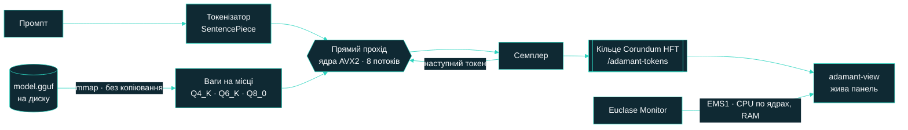
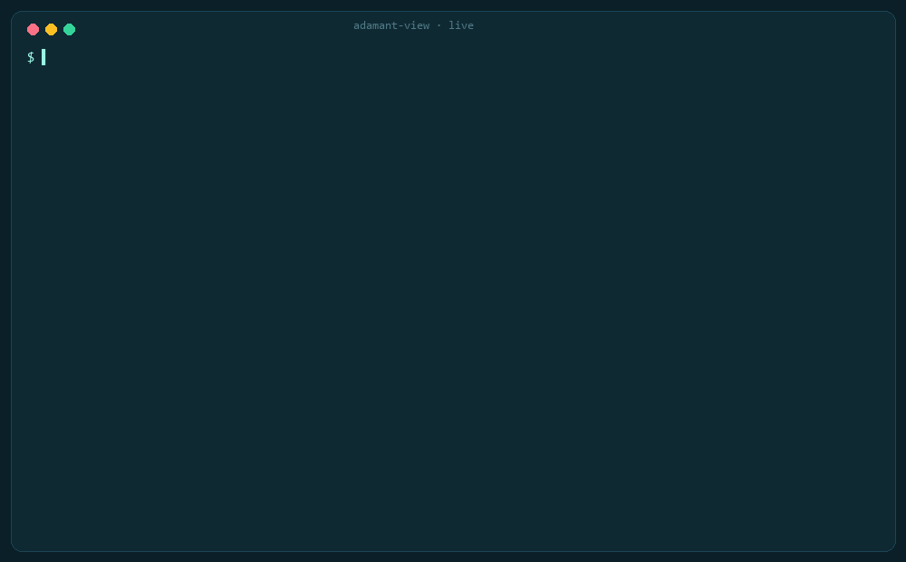
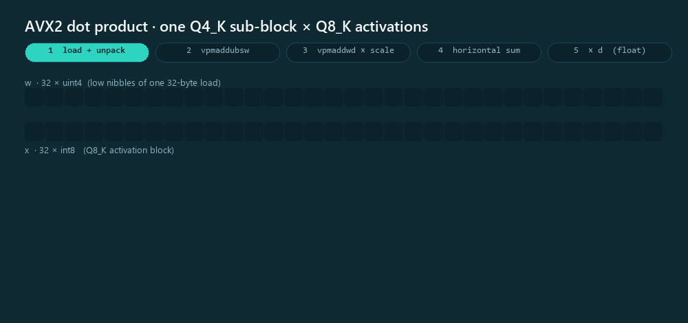
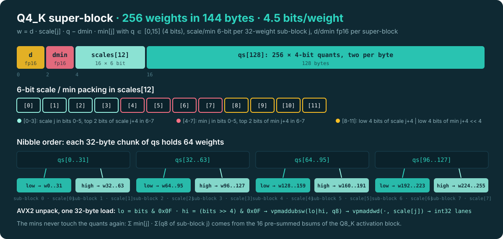
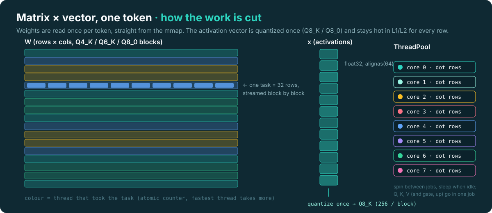
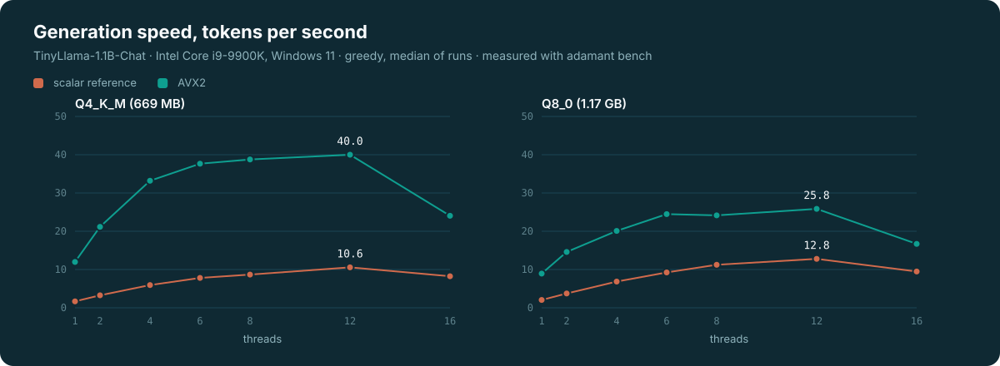
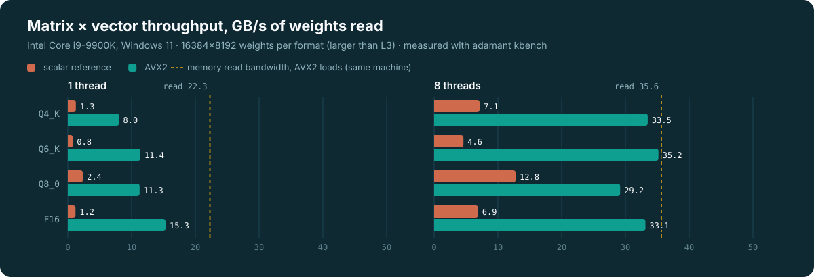
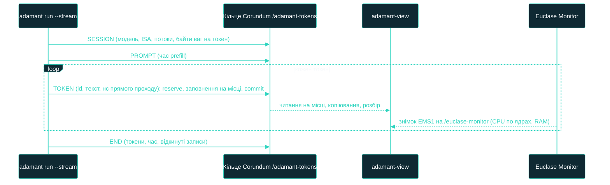

<p align="center"></p>

<p align="center">
  <a href="https://github.com/SemyonZamiakin/Adamant/actions/workflows/ci.yml"></a>
  
  
  
  
  
</p>

<h3 align="center">Велика мовна модель на вашому CPU, приблизно 3 100 рядків C++17.<br>Ваги читаються прямо з файлу. AVX2, написаний вручну, біт у біт збігається зі скалярним еталоном.</h3>

<p align="center">
  <a href="#подивитися-в-роботі">Демо</a> ·
  <a href="#швидкий-старт">Швидкий старт</a> ·
  <a href="#як-це-працює">Як це працює</a> ·
  <a href="#бенчмарки">Бенчмарки</a> ·
  <a href="#коректність">Коректність</a> ·
  <a href="docs/DESIGN.uk.md">Архітектура</a> ·
  <a href="README.md">English</a>
</p>

<p align="center"></p>

## Огляд і сценарії використання

> **Одним реченням:** Adamant завантажує квантовану LLM з файлу GGUF і генерує текст на звичайному процесорі x86-64; кожен гарячий цикл написаний вручну на AVX2 і перевірений біт у біт проти простої скалярної версії.

**Навіщо це.** Згенерувати токен означає прочитати кожну вагу моделі один раз. На CPU це передусім задача
пропускної здатності пам'яті, а вже потім арифметики, і більша частина роботи ховається в кількох циклах:
розпакувати 4- і 6-бітні числа, помножити, додати. Adamant — це ці цикли, виписані повністю й достатньо компактні,
щоб прочитати їх за вечір: завантажувач без копіювання, що відображає ваги прямо з диска, цілочисельні ядра AVX2
для блокових форматів, які популяризував llama.cpp, буфери, вирівняні на кеш-лінію, і прямий прохід для моделей
сімейства llama. Кожна цифра виміряна на машині, вказаній поруч, а кожне SIMD-ядро має скалярного двійника, з
яким мусить збігатися точно. Згенеровані токени й живе навантаження CPU / RAM проходять крізь решту стеку Euclase:
[Corundum HFT](https://github.com/SemyonZamiakin/CorundumHFT) і
[Euclase Monitor](https://github.com/SemyonZamiakin/EuclaseMonitor).

<table>
  <tr>
    <td width="33%" valign="top"><b>Локальний приватний інференс</b><br><sub>Спілкуйтеся з малою моделлю на ноутбуці чи старому десктопі: без GPU, без мережі, без Python. Один виконуваний файл і файл GGUF.</sub></td>
    <td width="33%" valign="top"><b>Зрозуміти, як насправді працює інференс</b><br><sub>Пакування бітів Q4_K, <code>vpmaddubsw</code>, KV-кеш, RoPE, grouped-query attention: кожне — кілька десятків читабельних рядків із тестом поруч.</sub></td>
    <td width="33%" valign="top"><b>Лабораторія ядер</b><br><sub>Спробуйте нове SIMD-ядро проти біт-точного скалярного еталона й побачте його ГБ/с поряд із виміряною пропускною здатністю пам'яті машини — однією командою.</sub></td>
  </tr>
  <tr>
    <td width="33%" valign="top"><b>Вбудувати LLM у застосунок C++</b><br><sub>Статична бібліотека з невеликим API (<code>Model</code>, <code>Tokenizer</code>, <code>Sampler</code>) і без залежностей, крім вбудованого кільця Corundum.</sub></td>
    <td width="33%" valign="top"><b>Передавати токени іншим процесам</b><br><sub>Токени й таймінги йдуть безблокувальним кільцем у спільній пам'яті: UI, логер чи гра читають їх без копіювання й ніколи не гальмують генерацію.</sub></td>
    <td width="33%" valign="top"><b>Відтворювані результати</b><br><sub>Жадібна генерація однакова на 1 чи 16 потоках, скалярно чи з AVX2: зручно для регресійних тестів і порівняння ядер.</sub></td>
  </tr>
</table>



**Вперше тут?** Подивіться [демо](#подивитися-в-роботі), потім пройдіть [швидкий старт](#швидкий-старт): одна збірка,
одне завантаження моделі, одна команда. Adamant має версію 0.1.0; розділ [Стан і обмеження](#стан-і-обмеження)
точно каже, що він уміє, а що ще ні.

<p align="center"></p>

<h3 align="center">У цифрах</h3>

<table align="center">
  <tr>
    <td align="center" width="25%"><h2>38.8 ток/с</h2><sub>генерація TinyLlama-1.1B Q4_K_M на i9-9900K, 8 потоків, AVX2</sub></td>
    <td align="center" width="25%"><h2>24.4 ГБ/с</h2><sub>ваг, прочитаних із DRAM під час генерації: 68 % виміряної швидкості читання пам'яті цієї машини</sub></td>
    <td align="center" width="25%"><h2>×7.8</h2><sub>AVX2 проти скалярного еталона, Q4_K матриця × вектор на одному ядрі (дані в кеші; ×6.4 з DRAM)</sub></td>
    <td align="center" width="25%"><h2>0 біт</h2><sub>різниці між AVX2 і скалярним кодом: ті самі логіти, ті самі токени (порівняно 3,8 млн результатів ядер)</sub></td>
  </tr>
</table>

<p align="center"></p>

## Подивитися в роботі

<p align="center"></p>

<p align="center"><sub>Справжній запис, відтворений у реальному часі: <code>adamant run --stream</code> генерує з TinyLlama-1.1B-Chat Q4_K_M; <code>adamant-view</code> читає токени з кільця Corundum, а навантаження ядер CPU і RAM — з кільця Euclase Monitor.</sub></p>

```text
$ adamant run -m tinyllama-1.1b-chat-v1.0.Q4_K_M.gguf --chat -p "Explain in three sentences what a CPU cache is."
model     tinyllama_tinyllama-1.1b-chat-v1.0 · 22 layers · dim 2048 · 32 heads (4 kv) · vocab 32000
weights   600.7 MiB, mapped zero-copy (F32 0.4 MiB, Q4_K 490.2 MiB, Q6_K 145.6 MiB)
runtime   avx2 kernels · 8 threads · ctx 2048 · KV cache 88.0 MiB · loaded in 23 ms

A CPU cache is a temporary storage area within the CPU that stores frequently accessed data and instructions. ...

prompt   28 tokens in 0.86 s (32.4 tok/s, one token at a time)
generate 110 tokens, 38.3 tok/s, 26.1 ms/token, weights streamed at 24.1 GB/s
```

## Швидкий старт

**1. Зібрати** (Windows з MSYS2 MinGW-w64 або Linux з GCC / Clang):

```bash
cmake -S . -B build -DCMAKE_BUILD_TYPE=Release
cmake --build build -j
ctest --test-dir build
```

На Windows з Git Bash чи PowerShell додайте `-G "MinGW Makefiles"` (або `-G Ninja`) і `C:\msys64\mingw64\bin` у `PATH`.
Виконувані файли: `build/adamant` і `build/adamant-view`.

**2. Взяти модель.** Підходить будь-який GGUF архітектури llama з тензорами Q4_K, Q6_K, Q8_0, F16 або F32 і словником
SentencePiece. Цифри в цьому README отримано на TinyLlama-1.1B-Chat v1.0 з
[TheBloke/TinyLlama-1.1B-Chat-v1.0-GGUF](https://huggingface.co/TheBloke/TinyLlama-1.1B-Chat-v1.0-GGUF):

| Файл | Розмір | SHA-256 |
|---|---|---|
| `tinyllama-1.1b-chat-v1.0.Q4_K_M.gguf` | 669 МБ | `9fecc3b3cd76bba89d504f29b616eedf7da85b96540e490ca5824d3f7d2776a0` |
| `tinyllama-1.1b-chat-v1.0.Q8_0.gguf` | 1,17 ГБ | `a4c9bb1dbaa372f6381a035fa5c02ef087aaa1ff1f843a56a22328114f03fc59` |

**3. Запустити:**

```bash
adamant run -m tinyllama-1.1b-chat-v1.0.Q4_K_M.gguf --chat -p "Write a haiku about vector registers."
adamant run -m tinyllama-1.1b-chat-v1.0.Q4_K_M.gguf -p "Once upon a time" -n 200 --temp 0.8 --seed 7
```

**4. Дивитися наживо** (другий термінал; запустіть також Euclase Monitor, щоб бачити навантаження ядер з його кільця):

```bash
adamant-view                      # чекає на генерацію
adamant run -m model.gguf --chat -p "..." --stream
```

## Як це працює

Увесь рушій тримається на чотирьох ідеях. Повна історія — в [docs/DESIGN.uk.md](docs/DESIGN.uk.md).

**1. Ніколи не копіювати ваги.** Файл GGUF відображається в пам'ять лише для читання (`mmap` /
`CreateFileMapping` + `MapViewOfFile`), і кожен тензор — це вказівник усередину відображення. Завантаження займає
мілісекунди, сторінки беруться з кешу ОС на вимогу, два процеси ділять одну копію, а модель, більша за вільну RAM,
підкачується з диска замість того, щоб завісити машину свопом.

**2. Цілочисельний SIMD на упакованих блоках.** Вектор активацій квантується до int8 один раз на добуток матриці;
далі кожен блок ваг розпаковується зсувами й масками й множиться через `vpmaddubsw` (u8 × s8 → пари int16) і
`vpmaddwd` (× масштаб блоку → int32). Одне 32-байтне завантаження несе 64 ваги Q4_K.

<p align="center"></p>

<p align="center"></p>

**3. Біт у біт зі скалярним кодом — за побудовою.** Ціла сума кожного блоку точна в будь-якому порядку, а дробові
масштаби застосовуються блок за блоком у тому самому порядку тими самими операціями (`-ffp-contract=off`). Дробові
скалярні добутки в увазі використовують ті самі 4 × 8 часткових сум і дерево редукції в обох версіях. Результат:
AVX2 і скалярний еталон дають ті самі логіти й ті самі токени, тож скалярний код — точний оракул для кожної зміни SIMD.

**4. Різати роботу під кеш і ядра.** Рядки роздаються потокам по 32 через один атомарний лічильник; Q, K і V (а
також gate і up у MLP) виконуються одним завданням; кожен буфер Adamant вирівняний на 64 байти й округлений до цілих
кеш-ліній; гарячі атоміки — кожен на своїй лінії.

<p align="center"></p>

## Бенчмарки

Виміряно на **Intel Core i9-9900K** (8 ядер / 16 потоків, Coffee Lake, AVX2), двоканальна DDR4, **Windows 11**,
Adamant зібрано MSYS2 GCC 15.2 `-O3`. Сирі журнали й CSV: [docs/bench/](docs/bench/).

### Швидкість генерації

<p align="center"></p>

| Потоки | Q4_K_M скалярно | Q4_K_M **AVX2** | прискорення | AVX2 ваги, ГБ/с | Q8_0 скалярно | Q8_0 **AVX2** | прискорення | AVX2 ваги, ГБ/с |
|---:|---:|---:|---:|---:|---:|---:|---:|---:|
| 1 | 1.67 | **12.0** | ×7.2 | 7.5 | 2.04 | **8.9** | ×4.4 | 9.8 |
| 2 | 3.25 | **21.2** | ×6.5 | 13.3 | 3.74 | **14.6** | ×3.9 | 16.0 |
| 4 | 5.94 | **33.2** | ×5.6 | 20.9 | 6.84 | **20.1** | ×2.9 | 22.1 |
| 6 | 7.81 | **37.7** | ×4.8 | 23.7 | 9.23 | **24.5** | ×2.7 | 26.9 |
| 8 (типово) | 8.66 | **38.8** | ×4.5 | 24.4 | 11.23 | **24.2** | ×2.2 | 26.6 |
| 12 | 10.57 | **40.0** | ×3.8 | 25.2 | 12.79 | **25.8** | ×2.0 | 28.4 |
| 16 | 8.24 | **24.0** | ×2.9 | 15.1 | 9.48 | **16.7** | ×1.8 | 18.3 |

<sub>Токени за секунду. Байтів ваг на токен: 630 МБ (Q4_K_M), 1 099 МБ (Q8_0). `adamant bench -m MODEL --isa scalar,avx2 -t 1,2,4,6,8,12,16 -n 64 --reps 3`: жадібна генерація після промпта з 8 токенів; медіана 3 прогонів AVX2 по 64 токени (скалярно: один прогін по 16 токенів).</sub>

**Та сама машина під Linux** (WSL2, ядро 6.18, GCC 15.2, модель на файловій системі Linux; `scripts/bench-linux.sh`):

| Потоки | Q4_K_M скалярно | Q4_K_M **AVX2** | Q8_0 скалярно | Q8_0 **AVX2** |
|---:|---:|---:|---:|---:|
| 1 | 1.71 | **13.0** | 2.08 | **9.1** |
| 4 | 5.90 | **38.3** | 7.14 | **19.9** |
| 8 | 9.62 | **45.0** | 11.64 | **21.8** |
| 12 | 11.76 | **44.7** | 12.46 | **22.1** |

<sub>Токени за секунду. Q4_K_M на 8 потоках тут читає 28,3 ГБ/с ваг проти 24,4 ГБ/с на Windows; причину ще не досліджено (планування потоків і поведінка таймерів у двох ядрах ОС різняться).</sub>

### Ядра

<p align="center"></p>

| Формат | біт/вагу | скалярно, 1 потік | **AVX2, 1 потік** | прискорення | скалярно, 8 потоків | **AVX2, 8 потоків** | AVX2, 1 потік, дані в L2/L3 | прискорення в кеші |
|---|---:|---:|---:|---:|---:|---:|---:|---:|
| Q4_K | 4.5 | 1.26 | **8.04** | ×6.4 | 7.14 | **33.5** | 9.10 | ×7.8 |
| Q6_K | 6.56 | 0.78 | **11.4** | ×14.6 | 4.59 | **35.2** | 14.8 | ×19.5 |
| Q8_0 | 8.5 | 2.35 | **11.3** | ×4.8 | 12.8 | **29.2** | 15.8 | ×7.0 |
| F16 | 16 | 1.20 | **15.3** | ×12.8 | 6.90 | **33.1** | 30.3 | ×25.4 |
| *читання пам'яті* | | | *22.3* | | | *35.6* | | |

<sub>ГБ/с ваг. Великий розмір: 16 384 × 8 192 ваг на формат (від 75 до 268 МБ); розмір у кеші: 1 024 × 2 048. `adamant kbench -t 1,8`, разом із квантуванням вхідного вектора. «Читання пам'яті» — та сама машина, що підсумовує буфер 1 ГіБ завантаженнями AVX2: орієнтир того, що віддає DRAM.</sub>

**Як читати ці цифри.** На всіх 8 ядрах ядра AVX2 читають ваги зі швидкістю 29-35 ГБ/с — приблизно ті 35,6 ГБ/с,
з якими ця машина взагалі здатна читати пам'ять: межа вже не в арифметиці, а в DRAM. Повний крок генерації
досягає 24,4 ГБ/с (Q4_K_M, 8 потоків, 68 % від цього), бо токен — це ще й увага, нормалізація, квантування
активацій і ~150 передач завдань у пулі потоків, а найменші матриці (K і V: 2048 × 256) закороткі, щоб завантажити
8 ядер. На одному ядрі картина інша: скалярний еталон упирається в арифметику, і AVX2 швидший у 4,8-14,6 раза (у
7-25 разів, коли дані в кеші). На 16 потоках генерація сповільнюється: воркери, що крутяться на гіперпотоках,
конкурують із тими, що працюють, тож типове значення — кількість фізичних ядер. Прогони відрізняються приблизно на
±10 % (інший прогін ядра Q4_K дав 28,7 замість 33,5 ГБ/с на 8 потоках); у журналах збережено всі прогони.

## Коректність

**Проти незалежного еталона.** [`scripts/reference_logits.py`](scripts/reference_logits.py) проганяє ту саму модель
у numpy з подвійною точністю, з вагами, деквантованими пакетом `gguf` з проєкту llama.cpp (не кодом Adamant), і
неквантованими активаціями. Логіти останньої позиції після промпта з 14 токенів
*«The capital of France is Paris, and the capital of Japan is»*:

| Модель | косинус | max \|Δ логіт\| | середнє \|Δ логіт\| | top-1 | збіг top-10 | KL(еталон ‖ Adamant) |
|---|---:|---:|---:|:---:|---:|---:|
| Q4_K_M | 0.99985 | 0.42 (діапазон −15.9 … 18.4) | 0.072 | той самий (`Tokyo`) | 9 / 10 | 4.5 × 10⁻⁵ нат |
| Q8_0 | 0.99996 | 0.20 (діапазон −16.4 … 18.7) | 0.035 | той самий (`Tokyo`) | 10 / 10 | 3.4 × 10⁻⁶ нат |

Невелика залишкова різниця — це 8-бітне квантування активацій перед кожним добутком матриці в Adamant (та сама схема,
що в llama.cpp на CPU). Обидві моделі відповідають *«Tokyo»*.

**Набори тестів** (на кожен push, Linux і Windows):

| Набір | Що доводить |
|---|---|
| `test_kernels` | AVX2 = скалярний код **біт у біт** на випадкових сирих блоках: 3,8 млн результатів для квантувальників, скалярних добутків і деквантувальників Q4_K / Q6_K / Q8_0 / F16 / F32, включно з рядками, вирівняними лише на 2 байти |
| `test_model` | синтетична модель llama з усіма форматами ваг проти **реалізації в подвійній точності**, написаної в тесті (косинус ≥ 0,999); 1 і 8 потоків, AVX2 і скалярний рушій — біт у біт |
| `test_quant` | похибка туди й назад для кожного формату на гаусових даних (Q8_0 0,54 %, Q6_K 1,9 %, Q4_K 7,9 % відносна RMSE); квантовані скалярні добутки проти дробових |
| `test_gguf` | запис → читання; обрізання на кожній довжині й 1 500 випадкових пошкоджень ніколи не читають за межами файлу |
| `test_tokenizer` | порядок злиття за балом, перехід на байти, спецтокени, декодування |
| `test_fp16` | усі 65 536 значень половинної точності проходять туди й назад; рівні випадки округлюються до парного |
| `test_thread_pool` | кожне завдання виконується рівно один раз у тисячах робіт, також після засинання воркерів |
| `test_stream` | записи проходять крізь справжнє кільце Corundum цілими; повне кільце відкидає, а не блокує |

Матриця CI: Linux GCC і Clang (Release, Debug), **AddressSanitizer + UndefinedBehaviorSanitizer**,
**ThreadSanitizer**, збірка без AVX2; Windows MinGW-w64 (MINGW64 і UCRT64).
Обидва файли TinyLlama також прогнано наскрізно під AddressSanitizer + UndefinedBehaviorSanitizer з перевіркою
витоків (Linux, GCC 15.2, скалярно й AVX2): жодного звіту.

## Інтеграція з Euclase



- **[Corundum HFT](https://github.com/SemyonZamiakin/CorundumHFT)** 1.2.0 вбудовано в `third_party/corundum`.
  Формат потоку токенів — [`include/adamant/token_wire.h`](include/adamant/token_wire.h); його структури перевіряє
  під час компіляції `CRD_WIRE_PACKED` з Corundum. Виробник ніколи не чекає: якщо ніхто не читає і кільце
  заповнилося, записи відкидаються й рахуються.
- **[Euclase Monitor](https://github.com/SemyonZamiakin/EuclaseMonitor)** 1.1 публікує знімки EMS1 на
  `/euclase-monitor`; `adamant-view` читає `cpu.core<N>.load`, `cpu.load`, `ram.used_gb`, `ram.total_gb` і
  `cpu.name`. Без Monitor переглядач сам знімає CPU і RAM. Кільце Corundum має одного читача, тож поки переглядач
  читає кільце Monitor, інший читач (Euclase Light) не може; `adamant-view --no-monitor` залишає його вільним.

## Довідник команд

| Команда | Що робить |
|---|---|
| `adamant run -m M -p TEXT [-n 128] [--chat] [--system S]` | генерація; `--temp`, `--top-k`, `--top-p`, `--repeat-penalty`, `--seed`, `-t`, `-c`, `--isa scalar\|avx2`, `--stream`, `--warm` |
| `adamant bench -m M [--isa scalar,avx2] [-t 1,8] [-n 64] [--csv F]` | токени/с і ГБ/с ваг від початку до кінця |
| `adamant kbench [-t 1,8] [--rows R --cols C] [--csv F]` | мікробенчмарк ядер і швидкість читання пам'яті, без моделі |
| `adamant info MODEL [--tensors]` | метадані, типи й розміри тензорів |
| `adamant logits -m M (--tokens 1,2,3 \| -p TEXT) [--out F]` | логіти останньої позиції для порівняння з еталоном |
| `adamant tokenize -m M -p TEXT [--chat]` | id токенів і фрагменти |
| `adamant-view [--record F.jsonl] [--exit-on-end] [--no-monitor]` | жива панель для `--stream` |

`ADAMANT_ISA=scalar` примусово вмикає скалярні ядра в будь-якій програмі, що лінкує бібліотеку.

## Стан і обмеження

Adamant 0.1.0 — робочий рушій, а не заміна llama.cpp. Що правда сьогодні:

- **Моделі:** лише архітектура llama (TinyLlama, моделі в стилі Llama-2, багато донавчених) з токенізатором
  SentencePiece. Словники BPE у стилі GPT-2 (Llama-3, Qwen, SmolLM) та інші архітектури відхиляються зі зрозумілою
  помилкою. Наскрізно перевірено на TinyLlama-1.1B-Chat v1.0 (Q4_K_M і Q8_0); інші файли мають працювати, якщо мають
  ті самі назви тензорів і формати, але не перевірялися.
- **Формати:** Q4_K, Q6_K, Q8_0, F16, F32. Немає Q2_K / Q3_K / Q5_K / Q4_0 / IQ; немає власного формату ваг.
- **Промпт обробляється по одному токену** (матриця × вектор, а не матриця × матриця): prefill іде приблизно зі
  швидкістю генерації. Пакетний prefill — найбільша відсутня оптимізація.
- **KV-кеш у float32**, контекст до довжини навчання моделі (TinyLlama: 2048, 88 МіБ кешу).
- **Лише x86-64** для SIMD: AVX2 + FMA + F16C, скалярний шлях усюди інде (його також збирають і тестують без AVX2).
  Поки немає AVX-512 і ARM NEON.
- **Бенчмарки з однієї машини** (i9-9900K) під Windows 11 і WSL2 Linux. На інших CPU буде інакше;
  надсилайте результати.
- **Переглядач — консольна панель**, а не застосунок у треї.
- Якість тексту — це якість моделі: TinyLlama — модель на 1,1 млрд параметрів, яка помиляється у фактах; Adamant
  відтворює її еталонні логіти, а не кращі відповіді.

## Плани

- Пакетний prefill (ядра матриця × матриця з тайлінгом по регістрах).
- Ядра AVX-512 / VNNI і ARM NEON з тим самим біт-точним скалярним контрактом.
- Токенізатор GPT-2 BPE (сімейства Llama-3, Qwen, SmolLM), формати Q5_K / Q4_0.
- Квантований (Q8) KV-кеш.

## Збірка

| | |
|---|---|
| **Windows** | MSYS2 MinGW-w64 GCC (перевірено 15.2, MINGW64 і UCRT64) або clang; `cmake -G "MinGW Makefiles"` чи `-G Ninja`. Виконувані файли лінкуються статично |
| **Linux** | GCC (перевірено 15.2) або Clang (перевірено 21.1); `scripts/check-linux.sh` збирає Release, ASan + UBSan і TSan обома |
| **Опції** | `-DADAMANT_AVX2=OFF` лише скалярно · `-DADAMANT_NATIVE=ON` `-march=native` · `-DADAMANT_SANITIZE=address,undefined` · `-DADAMANT_WERROR=ON` |

## Частина Euclase

| Проєкт | Що це |
|---|---|
| [Corundum HFT](https://github.com/SemyonZamiakin/CorundumHFT) | безблокувальне кільце IPC без копіювання: несе токени Adamant |
| [Euclase Monitor](https://github.com/SemyonZamiakin/EuclaseMonitor) | системний монітор: публікує метрики CPU і RAM, які показує переглядач |
| [Vajra Binary Core](https://github.com/SemyonZamiakin/VajraBinaryCore) | живе патчення й міграція типів у запущених програмах C++ |
| [Euclase SessionGuard](https://github.com/SemyonZamiakin/EuclaseSessionGuard) | локальний аудит сесій |

## Ліцензія

MIT, див. [LICENSE](LICENSE). Corundum HFT (вбудований) — MIT, ті самі автори. Файли моделей не входять до
репозиторію й мають власні ліцензії (TinyLlama: Apache-2.0).
