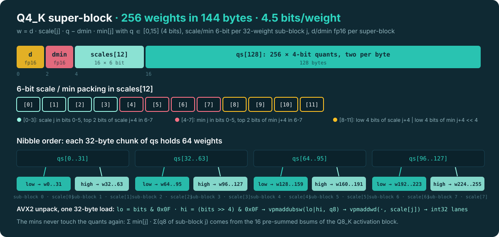
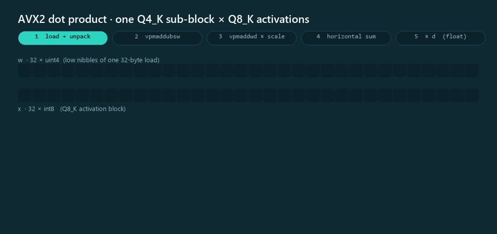
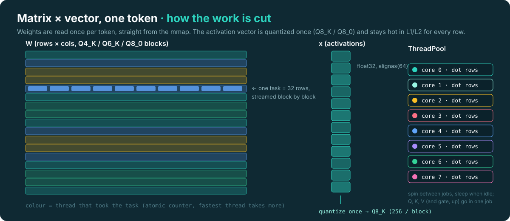

# Adamant SIMD-VIC: design

This document explains how Adamant turns a GGUF file into tokens, and why each piece looks the way it does.
It assumes you know roughly what a transformer is; it does not assume you have written SIMD code.

[Українська версія](DESIGN.uk.md)

**Contents**

1. [The problem: generation is a memory-bandwidth problem](#1-the-problem-generation-is-a-memory-bandwidth-problem)
2. [Zero-copy weights: mapping the file](#2-zero-copy-weights-mapping-the-file)
3. [Block formats](#3-block-formats)
4. [The kernels: scalar reference and AVX2](#4-the-kernels-scalar-reference-and-avx2)
5. [Why AVX2 is bit-identical to scalar](#5-why-avx2-is-bit-identical-to-scalar)
6. [Cache lines and alignment](#6-cache-lines-and-alignment)
7. [Threads](#7-threads)
8. [The forward pass](#8-the-forward-pass)
9. [Tokenizer](#9-tokenizer)
10. [Euclase integration: Corundum HFT and Euclase Monitor](#10-euclase-integration-corundum-hft-and-euclase-monitor)
11. [Testing strategy](#11-testing-strategy)

---

## 1. The problem: generation is a memory-bandwidth problem

To produce one token, a llama-style model multiplies a vector (the current hidden state, a few thousand floats)
by every weight matrix in the network once. For TinyLlama-1.1B that is about 1.1 billion multiply-adds, but it
also means **reading every weight once per token**: 0.64 GB for the Q4_K_M file, 1.1 GB for Q8_0.

The i9-9900K used for the benchmarks, with dual-channel DDR4, reads memory sequentially at **35.6 GB/s with
8 threads** (measured by `adamant kbench`, log in [bench/](bench/)), and 8 cores with AVX2 can do far more int8
arithmetic than that bandwidth can feed. So once the kernels are vectorized, the speed of
generation is set by **how fast the weights stream from DRAM**, and the design goals follow from that:

- never copy the weights (they are read in place from the mapped file);
- read each weight byte exactly once per token, sequentially, so the hardware prefetcher can keep up;
- keep everything else (activations, KV cache, scratch) small and cache-resident;
- make the arithmetic per byte cheap enough that a few cores saturate the memory bus.

`adamant bench` reports this directly as **GB/s of weights streamed**: `weight bytes per token × tokens/s`.

## 2. Zero-copy weights: mapping the file

`MappedFile` (`src/mmap_file.cpp`) maps the whole GGUF file read-only:

| | Linux | Windows |
|---|---|---|
| open | `open(O_RDONLY)` | `CreateFileW(GENERIC_READ, FILE_SHARE_READ, FILE_FLAG_RANDOM_ACCESS)` |
| map | `mmap(PROT_READ, MAP_PRIVATE)` | `CreateFileMappingW(PAGE_READONLY)` + `MapViewOfFile(FILE_MAP_READ)` |
| hint | `madvise(MADV_WILLNEED)` | `PrefetchVirtualMemory` (looked up at run time) |

Every `Tensor` holds a pointer into the mapping. Nothing proportional to the model size is allocated on the
heap. Consequences:

- **Loading is instant.** Opening a 1.1 GB model takes milliseconds; pages are read from disk the first time a
  kernel touches them (the first token is slower when the file is not in the OS cache).
- **The system does not hang on big models.** The pages are backed by the file, not by the page file or swap.
  Under memory pressure the OS can drop them and read them again later; a model larger than free RAM degrades
  to disk speed instead of pushing everything else into swap.
- **Several processes share one copy.** Two `adamant` processes on the same file share the same physical pages.

The parser (`src/gguf.cpp`) treats the file as untrusted: every string length, array count, tensor shape and
offset is checked against the file size before it is used, so a truncated download or a malicious file raises
an error instead of reading outside the mapping. `test_gguf` truncates a file at every length and flips random
bytes 1 500 times; the parser must either accept the file or throw.

## 3. Block formats

Weights are stored in blocks; each block holds a few fp16 scales and many small integers. The layouts are
byte-compatible with ggml, so any GGUF file produced by llama.cpp's tools works. Adamant implements the formats
that small llama models actually use:

| Format | Weights per block | Bytes | Bits per weight | Value |
|---|---|---|---|---|
| Q8_0 | 32 | 34 | 8.5 | `d · q`, q int8 |
| Q6_K | 256 | 210 | 6.5625 | `d · scale[j] · (q − 32)`, q 6-bit, 16 int8 sub-block scales |
| Q4_K | 256 | 144 | 4.5 | `d · scale[j] · q − dmin · min[j]`, q 4-bit, 8 six-bit scales and mins |
| F16, F32 | 1 | 2 / 4 | 16 / 32 | used for norms and some small tensors |

A "Q4_K_M" file is not all Q4_K: llama.cpp keeps the more sensitive tensors (some `attn_v`, `ffn_down`, the
output matrix) in Q6_K. `adamant info model.gguf` lists the mix.



## 4. The kernels: scalar reference and AVX2

The hot operation is a dot product between one weight row and the activation vector. Following ggml, Adamant
first **quantizes the activation vector** to 8 bits (Q8_K blocks of 256 for the K-quants, Q8_0 blocks of 32 for
Q8_0), once per matrix-vector product. The dot product then becomes integer arithmetic:

```
for each weight block:
    sumi = Σ  w_q[i] · x_q[i]             (integers; weight quants unpacked from 4/6/8 bits)
    sumf += w_scale · x_scale · sumi       (one float operation per block or sub-block)
```

Each kernel exists twice, behind one function-pointer table (`struct Kernels`, `include/adamant/quant.hpp`):

- `src/quant_scalar.cpp`: the **reference**. Plain loops, one element at a time, compiled with
  `-fno-tree-vectorize` so the compiler does not quietly turn it into SSE code.
- `src/quant_avx2.cpp`: **hand-written AVX2** with intrinsics, compiled with `-mavx2 -mfma -mf16c`, selected at
  run time when `cpuid` reports AVX2, FMA and F16C (`--isa` or `ADAMANT_ISA` override).

The AVX2 Q4_K kernel, for one 64-weight chunk:

```cpp
bits = _mm256_loadu_si256(q4 + 32*j);                  // 32 bytes = 64 nibbles
lo   = bits & 0x0F;  hi = (bits >> 4) & 0x0F;          // two 32-lane uint8 vectors
p0   = _mm256_maddubs_epi16(lo, q8[0:32]);             // u8 x s8, pairs summed -> 16 x int16
p1   = _mm256_maddubs_epi16(hi, q8[32:64]);
p0   = _mm256_madd_epi16(p0, set1_epi16(scale[2j]));   // x 6-bit scale, pairs summed -> 8 x int32
p1   = _mm256_madd_epi16(p1, set1_epi16(scale[2j+1]));
acc += p0 + p1;
```



The mins of Q4_K (`− dmin · min[j]`) never touch the quants again: `Σ min[j] · Σ x_q` over a sub-block only
needs the sum of the activation quants, which the Q8_K block already carries as 16 pre-computed `bsums`.

Q6_K needs one more trick: its quants are 6-bit unsigned with an offset of 32. `vpmaddubsw` needs one unsigned
operand, so the kernel computes `q·x − 32·x` as two `vpmaddubsw` and a subtraction, which stays inside int16
(`63·127·2 = 16 002`).

Ranges are chosen so nothing saturates: `vpmaddubsw` sums two products of at most `63 × 127`; activations are
quantized to `[−127, 127]` (never −128, which `vpsignb` could not negate).

## 5. Why AVX2 is bit-identical to scalar

Floating-point addition is not associative, so a SIMD kernel that keeps eight partial float sums normally gives
slightly different results from a scalar loop. Adamant avoids that by construction:

1. The integer part of each block (`sumi`) is computed exactly. Integer addition is associative, so the order
   of the 32 or 256 lanes does not matter, and the horizontal sum (`hsum_i32`, or four blocks at once with
   `vphaddd`) gives exactly the scalar value.
2. The float part (`sumf += d · dx · sumi`) is done **one block at a time, in block order, with the same
   operations in the same order** in both files.
3. The float-only dot products (`dot_f32`, `dot_f16`, used in attention and for F16 tensors) use the same
   4 × 8 partial sums and the same reduction tree in both versions, with separate multiply and add.
4. Both files are compiled with `-ffp-contract=off`, so the compiler cannot fuse `a·b + c` into an FMA in one
   file and not the other.

`test_kernels` feeds random raw bytes (every bit pattern the formats allow) and random activations through both
implementations and compares 3.8 million results with `memcmp`. The quantizers and dequantizers are checked the
same way. Since every kernel matches and the rest of the forward pass is shared code, the whole engine is
deterministic across ISAs: on TinyLlama, `--isa scalar` and `--isa avx2` generate the same token stream.

## 6. Cache lines and alignment

- `AlignedBuffer<T>` (`include/adamant/common.hpp`) allocates with `_aligned_malloc` / `posix_memalign` at
  **64 bytes** (`kCacheLine`) and rounds the size up to whole cache lines, so no two buffers share a line and a
  32-byte AVX2 load of an activation never straddles two lines. Activations, the KV cache, the RoPE tables,
  logits and the quantized activation blocks all live in such buffers.
- Hot atomics in the thread pool are `alignas(64)`, each on its own line, so the job counter and the
  completion counter do not ping-pong between cores (false sharing).
- Weights are read in place, with the alignment GGUF gives them (32 bytes per tensor). Blocks are 34, 144 or
  210 bytes, so a row can start at any even address; the kernels use unaligned loads (`vmovdqu`, no penalty on
  Haswell and later when the data does not cross a line, small when it does) and the parser refuses tensors that
  are not 2-byte aligned.
- On Windows, GCC cannot align the stack to 32 bytes for spilled `__m256` values (GCC bug 54412). The AVX2 file
  is built with `-Wa,-muse-unaligned-vector-move`, which makes the assembler emit unaligned moves for those
  spills.

## 7. Threads

`ThreadPool` (`src/thread_pool.cpp`) is a fork-join pool sized to the number of **physical** cores by default.
A matrix-vector product is cut into tasks of 32 rows. Tasks are handed out with one atomic counter, so a faster
core (or one not sharing its core with a hyper-thread) simply takes more of them.

One token needs about 150 such jobs, a few microseconds apart, so waking threads through the OS each time would
cost more than the work. Workers spin on an epoch counter with `pause` for a short while between jobs and fall
back to a condition variable when idle. A barrier at the end of each job (every worker checks in) guarantees no
worker still reads the job description when the next one is posted; `test_thread_pool` and ThreadSanitizer
check this.

Q, K and V share one input vector, as do the gate and up projections of the MLP, so each group runs as **one**
job over the rows of all its matrices.

Each row is computed by exactly one thread with the same instructions, so the result does not depend on the
number of threads; `test_model` checks that 1 and 8 threads give bit-identical logits.

On the i9-9900K generation is fastest with 8-12 threads; with all 16 hardware threads it drops, because spinning
workers share cores with the ones doing the work. That is why the default is the number of physical cores.

## 8. The forward pass

`Model::forward(token, pos)` (`src/model.cpp`) implements the llama architecture as llama.cpp's GGUF conversion
defines it:

```
x = embedding row of token (dequantized)
for each layer:
    h = rmsnorm(x) · attn_norm
    q, k, v = Wq·h, Wk·h, Wv·h                   (one job)
    rotate q, k with RoPE (adjacent pairs, base from metadata)
    append k, v to the KV cache (float32)
    attention per head, grouped-query: head h reads KV head h / (n_head / n_head_kv)
    x += Wo · attention
    h = rmsnorm(x) · ffn_norm
    x += Wdown · (silu(Wgate·h) * (Wup·h))        (gate and up in one job)
logits = Woutput · rmsnorm(x)                    (tied to the embedding if output.weight is absent)
```

Limits of version 0.1, honestly: the prompt is processed one token at a time (no batched matrix-matrix
prefill yet), the KV cache is float32, and only the llama architecture with the SentencePiece tokenizer is
supported.

## 9. Tokenizer

`Tokenizer` (`src/tokenizer.cpp`) is the SentencePiece-BPE variant used by llama-family GGUF files, written
to match llama.cpp: spaces become `U+2581`, a space is prepended to text that starts the input or follows a
special token, adjacent pieces are merged in order of the highest vocabulary score (a priority queue), and
characters with no piece fall back to `<0xXX>` byte tokens. Control tokens such as `</s>` are recognised in the
text only when asked (chat templates). Chat formatting supports the zephyr (`<|user|>`, TinyLlama-Chat), ChatML
and llama-2 `[INST]` templates, detected from `tokenizer.chat_template`.

## 10. Euclase integration: Corundum HFT and Euclase Monitor



**Token stream.** With `--stream`, `adamant run` creates the Corundum HFT ring `/adamant-tokens` (1 MiB) and
publishes one record per event, written straight into shared memory (`crd_reserve` → fill → `crd_commit`):
a session record (model, ISA, threads, weight bytes per token), a prompt record (prefill time), one record per
token (id, text, time of the forward pass that produced it) and an end record. The layouts are in
[`include/adamant/token_wire.h`](../include/adamant/token_wire.h) and are checked at compile time with
Corundum's `CRD_WIRE_PACKED` (no padding, natural alignment). The producer never waits: if nobody reads and the
ring fills, records are dropped and counted, so a stalled viewer can never slow generation down.

**Live metrics.** `adamant-view` reads that ring and, at the same time, Euclase Monitor's ring
`/euclase-monitor`, where Monitor publishes one EMS1 snapshot per update (per-core CPU load, RAM, CPU name...).
Both are read zero-copy; each record is copied out of shared memory before it is parsed, because the other
process could change it. Without Euclase Monitor, the viewer samples per-core load and RAM itself
(`NtQuerySystemInformation` / `GlobalMemoryStatusEx` on Windows, `/proc/stat` and `/proc/meminfo` on Linux).

A Corundum ring has exactly one reader. While `adamant-view` reads `/euclase-monitor`, another reader of that
ring (Euclase Light, for example) gets "busy"; `--no-monitor` leaves the ring alone.

## 11. Testing strategy

| Test | What it proves |
|---|---|
| `test_fp16` | every half-precision value round-trips; rounding is to nearest even |
| `test_quant` | quantize → dequantize error of each format on Gaussian data stays under a bound; quantized dot products agree with float dot products of the dequantized weights |
| `test_kernels` | AVX2 = scalar, bit for bit, on random raw blocks, for every quantizer, dot product and dequantizer, including pointers that are only 2-byte aligned |
| `test_gguf` | writer → reader round-trip; truncation at every length and random corruption never escape the mapping |
| `test_tokenizer` | merge order, byte fallback, special tokens, decoding |
| `test_thread_pool` | every task runs exactly once across thousands of jobs, including after workers fall asleep |
| `test_model` | a synthetic llama model using every weight format, run against an **independent double-precision implementation** of the same equations written in the test; 1 vs 8 threads bit-identical; AVX2 vs scalar engine |
| `test_stream` | records written by `TokenStream` arrive intact through a real Corundum ring; a full ring drops instead of blocking |

On a real model the reference comparison is done by `scripts/reference_logits.py` (numpy, double precision,
weights dequantized by the `gguf` Python package from the llama.cpp project, an implementation independent of
Adamant's); the results are in [bench/](bench/).

All tests run in CI on Linux (GCC, Clang, Debug, AddressSanitizer + UndefinedBehaviorSanitizer,
ThreadSanitizer, a build without AVX2) and Windows (MinGW-w64 MINGW64 and UCRT64).
