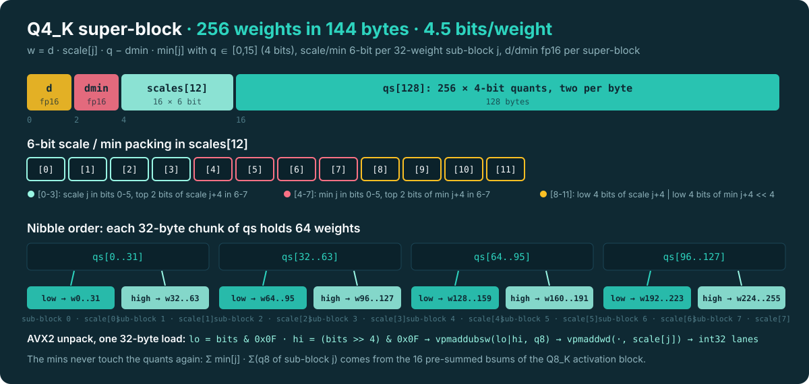
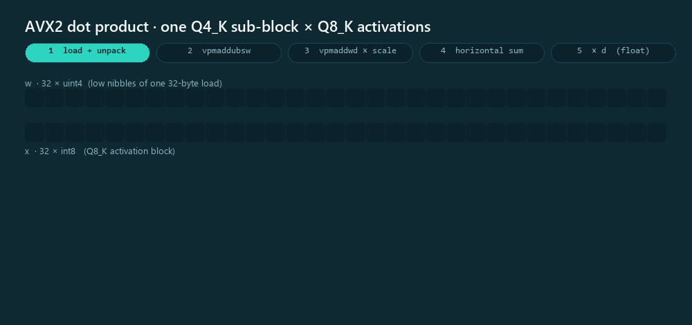
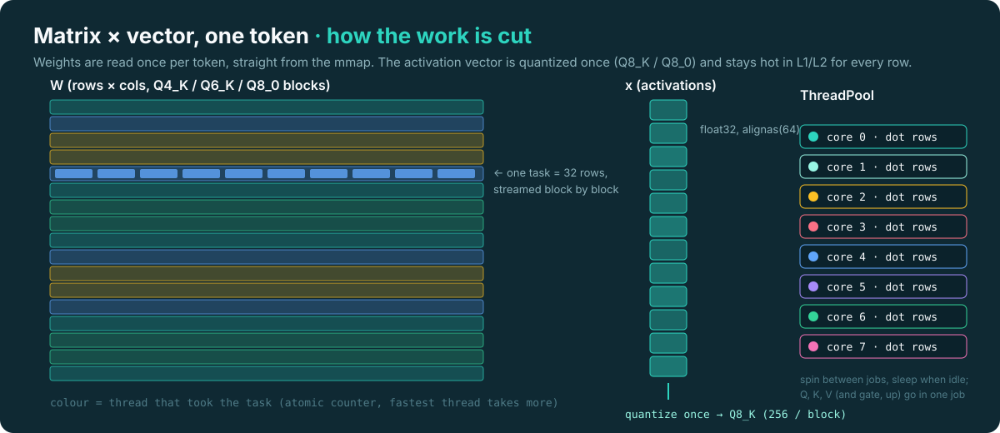

# Adamant SIMD-VIC: архітектура

Цей документ пояснює, як Adamant перетворює файл GGUF на токени і чому кожна частина влаштована саме так.
Передбачається, що ви приблизно знаєте, що таке трансформер; досвід написання SIMD-коду не потрібен.

[English version](DESIGN.md)

**Зміст**

1. [Задача: генерація впирається в пропускну здатність пам'яті](#1-задача-генерація-впирається-в-пропускну-здатність-памяті)
2. [Ваги без копіювання: відображення файлу в пам'ять](#2-ваги-без-копіювання-відображення-файлу-в-память)
3. [Блокові формати](#3-блокові-формати)
4. [Ядра: скалярний еталон і AVX2](#4-ядра-скалярний-еталон-і-avx2)
5. [Чому AVX2 збігається зі скалярним кодом біт у біт](#5-чому-avx2-збігається-зі-скалярним-кодом-біт-у-біт)
6. [Кеш-лінії та вирівнювання](#6-кеш-лінії-та-вирівнювання)
7. [Потоки](#7-потоки)
8. [Прямий прохід](#8-прямий-прохід)
9. [Токенізатор](#9-токенізатор)
10. [Інтеграція з Euclase: Corundum HFT і Euclase Monitor](#10-інтеграція-з-euclase-corundum-hft-і-euclase-monitor)
11. [Стратегія тестування](#11-стратегія-тестування)

---

## 1. Задача: генерація впирається в пропускну здатність пам'яті

Щоб видати один токен, модель архітектури llama множить вектор (поточний прихований стан, кілька тисяч чисел)
на кожну матрицю ваг мережі по одному разу. Для TinyLlama-1.1B це близько 1,1 мільярда множень із додаванням,
але також і **читання кожної ваги один раз на токен**: 0,64 ГБ для файлу Q4_K_M, 1,1 ГБ для Q8_0.

На i9-9900K з двоканальною DDR4 послідовне читання пам'яті дає **35,6 ГБ/с на 8 потоках** (виміряно
`adamant kbench`, журнал у [bench/](bench/)), а 8 ядер з AVX2 здатні на значно більший обсяг цілочисельної
арифметики int8. Тож коли ядра векторизовані, швидкість генерації визначається тим, **як швидко ваги
надходять із DRAM**, і з цього випливають цілі архітектури:

- ніколи не копіювати ваги (вони читаються на місці з відображеного файлу);
- читати кожен байт ваг рівно один раз на токен, послідовно, щоб апаратний префетчер встигав;
- усе інше (активації, KV-кеш, робочі буфери) тримати малим і в кеші;
- робити арифметику на байт настільки дешевою, щоб кілька ядер насичували шину пам'яті.

`adamant bench` показує це прямо як **ГБ/с прочитаних ваг**: `байти ваг на токен × токени/с`.

## 2. Ваги без копіювання: відображення файлу в пам'ять

`MappedFile` (`src/mmap_file.cpp`) відображає весь файл GGUF лише для читання:

| | Linux | Windows |
|---|---|---|
| відкриття | `open(O_RDONLY)` | `CreateFileW(GENERIC_READ, FILE_SHARE_READ, FILE_FLAG_RANDOM_ACCESS)` |
| відображення | `mmap(PROT_READ, MAP_PRIVATE)` | `CreateFileMappingW(PAGE_READONLY)` + `MapViewOfFile(FILE_MAP_READ)` |
| підказка ОС | `madvise(MADV_WILLNEED)` | `PrefetchVirtualMemory` (шукається під час виконання) |

Кожен `Tensor` містить вказівник усередину відображення. У купі не виділяється нічого, що зростало б разом із
розміром моделі. Наслідки:

- **Завантаження миттєве.** Відкриття моделі на 1,1 ГБ займає мілісекунди; сторінки читаються з диска, коли ядро
  вперше до них звертається (перший токен повільніший, якщо файлу ще немає в кеші ОС).
- **Система не зависає на великих моделях.** Сторінки забезпечені файлом, а не файлом підкачки. Під тиском
  пам'яті ОС може їх відкинути й прочитати знову; модель, більша за вільну RAM, просто працює зі швидкістю диска,
  а не витісняє все інше в своп.
- **Кілька процесів ділять одну копію.** Два процеси `adamant` над одним файлом використовують ті самі фізичні
  сторінки.

Парсер (`src/gguf.cpp`) вважає файл недовіреним: кожна довжина рядка, кількість елементів масиву, форма тензора
і зміщення перевіряються відносно розміру файлу до використання, тож обрізане завантаження чи зловмисний файл
призводять до помилки, а не до читання за межами відображення. `test_gguf` обрізає файл на кожній довжині та
1 500 разів псує випадкові байти; парсер має або прийняти файл, або кинути виняток.

## 3. Блокові формати

Ваги зберігаються блоками; кожен блок містить кілька масштабів fp16 і багато малих цілих чисел. Розкладки
байт-сумісні з ggml, тож підходить будь-який GGUF, створений інструментами llama.cpp. Adamant реалізує формати,
які реально використовують малі моделі llama:

| Формат | Ваг у блоці | Байтів | Біт на вагу | Значення |
|---|---|---|---|---|
| Q8_0 | 32 | 34 | 8,5 | `d · q`, q — int8 |
| Q6_K | 256 | 210 | 6,5625 | `d · scale[j] · (q − 32)`, q — 6 біт, 16 масштабів int8 на підблоки |
| Q4_K | 256 | 144 | 4,5 | `d · scale[j] · q − dmin · min[j]`, q — 4 біти, 8 шестибітних масштабів і мінімумів |
| F16, F32 | 1 | 2 / 4 | 16 / 32 | для норм і деяких малих тензорів |

Файл «Q4_K_M» — не суцільний Q4_K: llama.cpp тримає чутливіші тензори (частину `attn_v`, `ffn_down`, вихідну
матрицю) у Q6_K. `adamant info model.gguf` показує суміш.



## 4. Ядра: скалярний еталон і AVX2

Гаряча операція — скалярний добуток рядка ваг на вектор активацій. Як і ggml, Adamant спершу **квантує вектор
активацій** до 8 біт (блоки Q8_K по 256 для K-форматів, блоки Q8_0 по 32 для Q8_0) один раз на добуток
матриці на вектор. Тоді скалярний добуток стає цілочисельною арифметикою:

```
для кожного блоку ваг:
    sumi = Σ  w_q[i] · x_q[i]             (цілі; кванти ваг розпаковано з 4/6/8 біт)
    sumf += w_scale · x_scale · sumi       (одна операція з рухомою комою на блок або підблок)
```

Кожне ядро існує двічі, за однією таблицею вказівників на функції (`struct Kernels`, `include/adamant/quant.hpp`):

- `src/quant_scalar.cpp` — **еталон**. Прості цикли по одному елементу, зібрані з `-fno-tree-vectorize`, щоб
  компілятор непомітно не перетворив їх на SSE-код.
- `src/quant_avx2.cpp` — **AVX2, написаний вручну** на інтринсиках, зібраний з `-mavx2 -mfma -mf16c`, обирається
  під час виконання, коли `cpuid` повідомляє AVX2, FMA і F16C (перевизначення: `--isa` або `ADAMANT_ISA`).

Ядро AVX2 для Q4_K, один фрагмент із 64 ваг:

```cpp
bits = _mm256_loadu_si256(q4 + 32*j);                  // 32 байти = 64 ніббли
lo   = bits & 0x0F;  hi = (bits >> 4) & 0x0F;          // два вектори по 32 uint8
p0   = _mm256_maddubs_epi16(lo, q8[0:32]);             // u8 x s8, пари підсумовано -> 16 x int16
p1   = _mm256_maddubs_epi16(hi, q8[32:64]);
p0   = _mm256_madd_epi16(p0, set1_epi16(scale[2j]));   // x 6-бітний масштаб, пари підсумовано -> 8 x int32
p1   = _mm256_madd_epi16(p1, set1_epi16(scale[2j+1]));
acc += p0 + p1;
```



Мінімуми Q4_K (`− dmin · min[j]`) більше не торкаються квантів: `Σ min[j] · Σ x_q` по підблоку потребує лише суми
квантів активацій, яку блок Q8_K уже несе як 16 заздалегідь обчислених `bsums`.

Для Q6_K потрібен ще один прийом: його кванти — 6-бітні беззнакові зі зміщенням 32. `vpmaddubsw` потребує
одного беззнакового операнда, тож ядро рахує `q·x − 32·x` як два `vpmaddubsw` і віднімання, що лишається в межах
int16 (`63·127·2 = 16 002`).

Діапазони підібрано так, щоб нічого не насичувалося: `vpmaddubsw` додає два добутки не більше `63 × 127`;
активації квантуються в `[−127, 127]` (ніколи −128, яке `vpsignb` не змогло б змінити на протилежне).

## 5. Чому AVX2 збігається зі скалярним кодом біт у біт

Додавання з рухомою комою не асоціативне, тож SIMD-ядро з вісьмома частковими сумами зазвичай дає трохи інші
результати, ніж скалярний цикл. Adamant уникає цього за побудовою:

1. Цілочисельна частина кожного блоку (`sumi`) рахується точно. Додавання цілих асоціативне, тож порядок 32 чи
   256 доріжок не має значення, а горизонтальна сума (`hsum_i32` або чотири блоки одразу через `vphaddd`) дає
   саме скалярне значення.
2. Частина з рухомою комою (`sumf += d · dx · sumi`) робиться **по одному блоку, у порядку блоків, тими самими
   операціями в тому самому порядку** в обох файлах.
3. Скалярні добутки лише з рухомою комою (`dot_f32`, `dot_f16`, в увазі та для тензорів F16) в обох версіях
   використовують ті самі 4 × 8 часткових сум і те саме дерево редукції, з окремими множенням і додаванням.
4. Обидва файли зібрано з `-ffp-contract=off`, щоб компілятор не злив `a·b + c` у FMA в одному файлі й не в іншому.

`test_kernels` пропускає випадкові сирі байти (кожен бітовий шаблон, який допускають формати) і випадкові
активації через обидві реалізації та порівнює 3,8 мільйона результатів через `memcmp`. На реальній моделі
`--isa scalar` і `--isa avx2` генерують однаковий потік токенів.

## 6. Кеш-лінії та вирівнювання

- `AlignedBuffer<T>` (`include/adamant/common.hpp`) виділяє пам'ять через `_aligned_malloc` / `posix_memalign` з
  вирівнюванням **64 байти** (`kCacheLine`) і округлює розмір до цілих кеш-ліній, тож два буфери ніколи не ділять
  лінію, а 32-байтне завантаження AVX2 активацій ніколи не перетинає дві лінії. Активації, KV-кеш, таблиці RoPE,
  логіти і квантовані блоки активацій живуть у таких буферах.
- Гарячі атоміки пулу потоків — `alignas(64)`, кожен на своїй лінії, тож лічильник завдань і лічильник
  завершення не перекидаються між ядрами (false sharing).
- Ваги читаються на місці з тим вирівнюванням, яке дає GGUF (32 байти на тензор). Блоки мають 34, 144 або 210
  байтів, тож рядок може починатися з будь-якої парної адреси; ядра використовують невирівняні завантаження, а
  парсер відхиляє тензори без вирівнювання на 2 байти.
- На Windows GCC не вміє вирівнювати стек на 32 байти для витіснених значень `__m256` (баг GCC 54412). Файл AVX2
  збирається з `-Wa,-muse-unaligned-vector-move`, і асемблер генерує для них невирівняні пересилання.

## 7. Потоки

`ThreadPool` (`src/thread_pool.cpp`) — пул fork-join, за замовчуванням за кількістю **фізичних** ядер. Добуток
матриці на вектор ріжеться на завдання по 32 рядки, які роздаються одним атомарним лічильником: швидше ядро
просто бере їх більше.

Один токен — це близько 150 таких завдань із інтервалом у кілька мікросекунд, тож будити потоки через ОС щоразу
коштувало б дорожче за саму роботу. Між завданнями воркери недовго крутяться на лічильнику епох з `pause` і
засинають на умовній змінній, коли роботи немає. Бар'єр наприкінці кожного завдання гарантує, що жоден воркер ще
не читає опис завдання, коли публікується наступне; це перевіряють `test_thread_pool` і ThreadSanitizer.

На i9-9900K найкраща швидкість на 8-12 потоках; на 16 (усі гіперпотоки) вона падає, бо потоки, що крутяться в
очікуванні, ділять ядра з тими, що працюють. Тому типове значення — кількість фізичних ядер.

Q, K і V мають спільний вхідний вектор, так само як gate і up у MLP, тож кожна група виконується **одним**
завданням над рядками всіх своїх матриць. Кожен рядок рахує рівно один потік тими самими інструкціями, тож
результат не залежить від кількості потоків.

## 8. Прямий прохід

`Model::forward(token, pos)` (`src/model.cpp`) реалізує архітектуру llama так, як її визначає конвертація GGUF у
llama.cpp:

```
x = рядок вбудовування токена (деквантований)
для кожного шару:
    h = rmsnorm(x) · attn_norm
    q, k, v = Wq·h, Wk·h, Wv·h                   (одне завдання)
    повернути q, k через RoPE (сусідні пари, основа з метаданих)
    додати k, v до KV-кешу (float32)
    увага по головах, grouped-query: голова h читає KV-голову h / (n_head / n_head_kv)
    x += Wo · увага
    h = rmsnorm(x) · ffn_norm
    x += Wdown · (silu(Wgate·h) * (Wup·h))        (gate і up одним завданням)
logits = Woutput · rmsnorm(x)                    (спільна з вбудовуванням, якщо output.weight відсутня)
```

Чесні обмеження версії 0.1: промпт обробляється по одному токену (ще немає пакетного prefill матриця × матриця),
KV-кеш у float32, підтримується лише архітектура llama з токенізатором SentencePiece.

## 9. Токенізатор

`Tokenizer` (`src/tokenizer.cpp`) — варіант SentencePiece-BPE, який використовують GGUF-файли сімейства llama,
написаний відповідно до llama.cpp: пробіли стають `U+2581`, перед текстом на початку вводу або після спецтокена
додається пробіл, сусідні фрагменти зливаються в порядку найвищого балу словника (черга з пріоритетом), а символи
без фрагмента переходять у байтові токени `<0xXX>`. Керівні токени на кшталт `</s>` розпізнаються в тексті лише на
запит (шаблони чату). Підтримуються шаблони zephyr (`<|user|>`, TinyLlama-Chat), ChatML і llama-2 `[INST]`;
вибір — за `tokenizer.chat_template`.

## 10. Інтеграція з Euclase: Corundum HFT і Euclase Monitor



**Потік токенів.** З `--stream` команда `adamant run` створює кільце Corundum HFT `/adamant-tokens` (1 МіБ) і
публікує один запис на подію, записуючи прямо в спільну пам'ять (`crd_reserve` → заповнення → `crd_commit`):
запис сесії (модель, ISA, потоки, байти ваг на токен), запис промпта (час prefill), по запису на токен (id, текст,
час прямого проходу, що його породив) і запис завершення. Розкладки — в
[`include/adamant/token_wire.h`](../include/adamant/token_wire.h); їх перевіряє під час компіляції
`CRD_WIRE_PACKED` з Corundum (без доповнення, природне вирівнювання). Виробник ніколи не чекає: якщо ніхто не
читає і кільце заповнилося, записи відкидаються й рахуються, тож завислий переглядач ніколи не сповільнить
генерацію.

**Живі метрики.** `adamant-view` читає це кільце і водночас кільце Euclase Monitor `/euclase-monitor`, де Monitor
публікує по знімку EMS1 на оновлення (завантаження кожного ядра CPU, RAM, назва CPU...). Обидва читаються без
копіювання; кожен запис копіюється зі спільної пам'яті перед розбором, бо інший процес міг би його змінити. Без
Euclase Monitor переглядач сам знімає завантаження ядер і RAM (`NtQuerySystemInformation` / `GlobalMemoryStatusEx`
на Windows, `/proc/stat` і `/proc/meminfo` на Linux).

Кільце Corundum має рівно одного читача. Поки `adamant-view` читає `/euclase-monitor`, інший читач цього кільця
(наприклад, Euclase Light) отримає «зайнято»; `--no-monitor` залишає кільце вільним.

## 11. Стратегія тестування

| Тест | Що він доводить |
|---|---|
| `test_fp16` | кожне значення половинної точності проходить туди й назад; округлення до найближчого парного |
| `test_quant` | похибка квантування → деквантування кожного формату на гаусових даних у межах; квантовані скалярні добутки узгоджуються з дробовими |
| `test_kernels` | AVX2 = скалярний код біт у біт на випадкових сирих блоках для всіх квантувальників, скалярних добутків і деквантувальників, включно з рядками, вирівняними лише на 2 байти |
| `test_gguf` | запис → читання; обрізання на кожній довжині та випадкове псування ніколи не виходять за межі відображення |
| `test_tokenizer` | порядок злиття, перехід на байти, спецтокени, декодування |
| `test_thread_pool` | кожне завдання виконується рівно один раз у тисячах робіт, зокрема після засинання воркерів |
| `test_model` | синтетична модель llama з усіма форматами ваг проти **незалежної реалізації в подвійній точності**, написаної в тесті; 1 і 8 потоків, AVX2 і скалярний рушій — біт у біт |
| `test_stream` | записи `TokenStream` проходять крізь справжнє кільце Corundum цілими; повне кільце відкидає, а не блокує |

На реальній моделі порівняння з еталоном робить `scripts/reference_logits.py` (numpy, подвійна точність, ваги
деквантує пакет Python `gguf` з проєкту llama.cpp — реалізація, незалежна від Adamant); результати в [bench/](bench/).

Усі тести виконуються в CI на Linux (GCC, Clang, Debug, AddressSanitizer + UndefinedBehaviorSanitizer,
ThreadSanitizer, збірка без AVX2) і Windows (MinGW-w64 MINGW64 і UCRT64).
